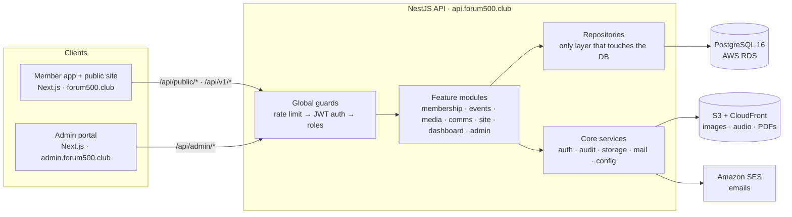
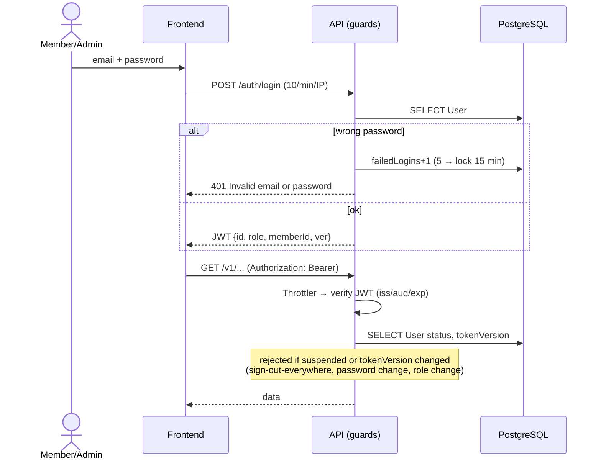
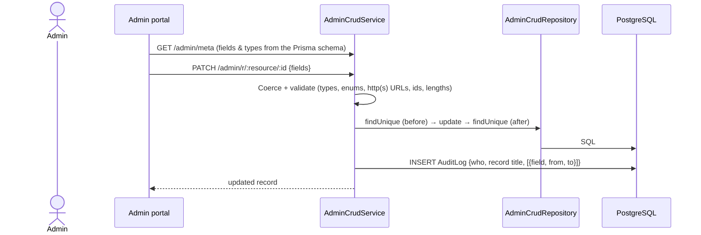
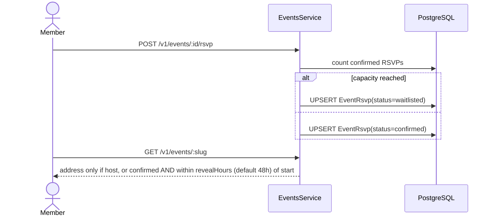
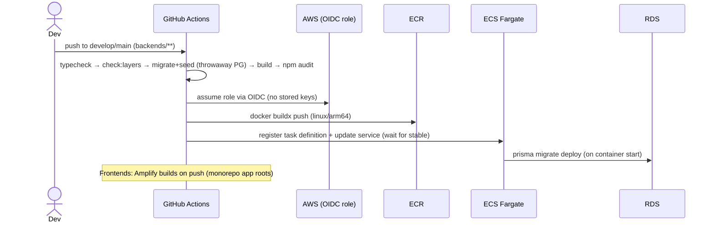
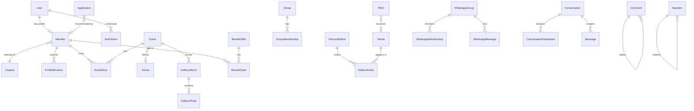

# Forum500 Platform: Technical Overview

**Prepared:** 19 Oct 2026
**Status:** working end to end on local; AWS deployment files are ready but no AWS resources have been created yet.
**Repo:** `Forum500/Monorepo`
- `backends/`: NestJS API
- `frontends/admin`: admin portal
- `frontends/web`: member app and public site

---

## 1. Summary of the work

The starting point was a **Lovable prototype**. It had 35 screens built in TanStack Start, and every piece of data was hard-coded in the frontend. Login used Supabase. The prototype had no backend, no admin and no real data flow.

**Delivered:**
1. **Monorepo** with three independently deployable apps, in the same layout as our existing andovi repo:
   - API (NestJS + PostgreSQL)
   - Admin portal (Next.js)
   - Member app and public site (Next.js)
2. **Database:**
   - 58 tables and 27 enums, built with 3 migrations. A fresh database builds to exactly the current schema, with no drift.
   - Seeded with every record from the prototype.
3. **Backend structure:** one module per area of the product (Membership, Events, Media, Communications, Site/CMS, Dashboard, Admin).
   - Every module uses **Controller → Service → Repository** layers.
   - Only repository files touch the database. A CI check enforces this.
4. **Admin portal:** full create, read, update, delete and publish control over **52 resources**.
   - A single Approvals inbox covers 13 moderation queues.
   - Workflows: approve applications, review profile updates, accept article pitches, manage user accounts, upload files.
   - A human-readable audit log records every admin change: who, what, which record, and before → after per field.
5. **Member app:** all 36 screens ported to Next.js and running on live API data, with no hard-coded content left.
   - Approval flow: everything a member submits (event proposals, benefit offers, groups, comments, posts, pitches, profile updates) goes to the admin for approval.
   - New features beyond the prototype: **real direct messaging** and **chapter group chat**.
6. **CMS:** homepage, about page, page headers, navigation menus, home cards, Ask Zola prompts and club benefits are all editable in the admin without a code deploy.
7. **Security hardening** (§7): invite-only onboarding, password policy, account lockout, instant session revocation, rate limiting, upload content-checking, input validation, audit trail, and a production config guard.
8. **AWS-ready infrastructure:**
   - S3 and SES integrations, verified locally against LocalStack, an AWS emulator.
   - Production Docker image.
   - ECS task definition and least-privilege IAM policies.
   - GitHub Actions deploy to ECR/ECS using OIDC, so no AWS keys are stored in GitHub.
   - Amplify build specs for the two frontends.
   - A step-by-step AWS setup guide with cost estimate.
   - **Terraform** for the whole AWS stack, staging and production (`infra/terraform`, see `docs/TERRAFORM.md`). It is validated and plan-tested offline, but not yet applied.

**Verification:**
| Check | Result |
|---|---|
| Automated admin API suite (all 52 resources × list/search/get/create/update/status/delete, all workflows, uploads, 25 security cases) | **473 / 473 pass** |
| Member app browser test (headless Chrome, real login, sends DMs, posts in group chat, etc.) | **17 / 17 pass** |
| Every page loads with no JS errors, failed API calls or broken images | all pages pass (4 admin edit pages were checked separately) |
| Apply → approve → invite link → set password → login, in a real browser | pass |
| API response snapshot before vs. after the backend refactor (35 endpoints) | identical, apart from intentional fixes |
| Production container in production mode (refuses weak secrets, runs as non-root, migrates on boot) | pass |
| S3 upload, presigned upload, delete and SES email against LocalStack | pass |

---

## 2. Architecture



**API surface:**
| Prefix | Who | Rules |
|---|---|---|
| `/api/public/*` | anyone | site content, apply form, public In:Forum |
| `/api/v1/*` | signed-in members | only *published* content; members can only change their own data |
| `/api/admin/*` | admins | everything, through a metadata-driven CRUD engine plus workflow endpoints |
| `/api/health` | load balancer | process + database check |

**Repository layout:**
```
backends/src/
  core/      auth · audit · storage(S3) · mail(SES) · config · health · prisma
  modules/   membership · events · media · comms · site · dashboard · admin
             └─ <feature>.controller.ts → <feature>.service.ts → <feature>.repository.ts
frontends/admin  frontends/web     infra/aws     docs/     .github/workflows/
```

---

## 3. Packages and what each is used for

### 3.1 API (`backends/`): Node 20, TypeScript
| Package | Version | Used for |
|---|---|---|
| `@nestjs/core`, `@nestjs/common`, `@nestjs/platform-express` | 11.2.7 | API framework: modules, controllers, dependency injection |
| `@nestjs/config` | 4 | Loading `.env` |
| `zod` | 3.25 | Validating every request body and the environment config (the app refuses to start in production with weak settings) |
| `@prisma/client`, `prisma` | 6.19.3 | ORM, type-safe queries, migrations |
| `@nestjs/jwt` | 11 | Signing and verifying login tokens (HS256, issuer/audience checked) |
| `argon2` | 0.44 | Password hashing (argon2id) |
| `@nestjs/throttler` | 6.7 | Rate limiting: global, plus stricter limits on login, password reset, apply and uploads |
| `helmet` | 8.1 | Security headers (HSTS, nosniff, frame protection) |
| `@nestjs/swagger` | 11.4 | API docs at `/docs` (disabled in production) |
| `@nestjs/serve-static` | 5 | Serving local uploads and seed images in development |
| `@aws-sdk/client-s3`, `@aws-sdk/s3-request-presigner` | 3.x | File storage on S3, including presigned direct-from-browser uploads |
| `@aws-sdk/client-ses` | 3.x | Sending email through Amazon SES |
| `multer` (via platform-express) | 2.x | Receiving multipart file uploads |
| `tsx`, `dotenv` (dev) | | Running the seed script |

### 3.2 Admin portal (`frontends/admin`) and member app (`frontends/web`)
| Package | Version | Used for |
|---|---|---|
| `next`, `react`, `react-dom` | 15.5 / 19 | App Router frontends |
| `tailwindcss`, `@tailwindcss/postcss`, `tw-animate-css` | 4.x | Styling (same brand theme as the prototype) |
| `@radix-ui/*` + shadcn/ui components | | Accessible UI primitives (dialogs, selects, tabs, popovers…) |
| `@tanstack/react-query` | 5 | API data fetching, caching, refetching, mutations |
| `@tanstack/react-table` | 8 | Admin data tables with server-side paging, sorting and filters (admin only) |
| `react-hook-form` | 7 | Admin forms generated from API metadata (admin only) |
| `cmdk` | 1 | Searchable relation pickers (admin only) |
| `lucide-react` | | Icons; the CMS stores icon names |
| `sonner` | 2 | Toast notifications |
| `date-fns` | 4 | Date formatting |
| `clsx`, `tailwind-merge`, `class-variance-authority` | | Class-name utilities |

### 3.3 Tooling and infrastructure
| Tool | Used for |
|---|---|
| Docker / docker-compose | Local Postgres 16. LocalStack (AWS emulator for S3 and SES) behind the `aws` profile |
| GitHub Actions | CI per app, filtered by path. API: typecheck → layer check → migrate → seed → build → audit → ECR/ECS deploy |
| `scripts/check-layers.mjs` | Fails CI if any non-repository file accesses the database |
| **Terraform 1.9** + AWS provider 5.x | Creates all AWS resources (VPC, RDS, S3/CloudFront, SES, ECR, ECS/ALB, IAM/OIDC, Secrets Manager, WAF, alarms, Amplify). Offline plan tests in CI |
| `scripts/create-admin.mjs` | Creates or resets an admin login on any environment (runs inside the production image) |
| puppeteer-core + Chrome | Browser end-to-end tests (test harness, not shipped) |

---

## 4. Services: in use now vs. planned

**Legend:**
- ✅ in use and working
- 🟡 code written and tested locally; the cloud resource isn't created yet
- ⛔ not started

| Service | Purpose | Status | Notes |
|---|---|---|---|
| PostgreSQL 16 | Primary database | ✅ local (Docker) → 🟡 **AWS RDS** | Set `DATABASE_URL` to RDS; migrations run on container start |
| Local disk storage | Uploads in development | ✅ dev only | Blocked in production by the config guard |
| **Amazon S3 + CloudFront** | Images, audio, PDFs | 🟡 | `STORAGE_DRIVER=s3`; verified on LocalStack |
| Email to console | Development email | ✅ dev only | Why no real emails arrive locally |
| **Amazon SES** | Invite, password-reset and application-decision emails | 🟡 | `MAIL_DRIVER=ses`; needs domain verification and SES production access |
| **AWS ECS Fargate + ALB + ECR** | Hosting the API | 🟡 | `infra/aws/ecs-task-definition.json`, Dockerfile, GitHub workflow |
| **AWS Amplify Hosting** | Hosting the two Next.js apps | 🟡 | `amplify.yml` per app |
| **AWS Secrets Manager** | `DATABASE_URL`, `JWT_SECRET` | 🟡 | Wired into the ECS task definition |
| **IAM (task roles, GitHub OIDC)** | No static AWS keys anywhere | 🟡 | Least-privilege policies in `infra/aws/*.json` |
| CloudWatch | Logs and alarms | 🟡 | Log group configured; alarms listed in the setup guide |
| AWS WAF | Edge protection and rate limits | ⛔ | Recommended before launch |
| Redis (ElastiCache) | Shared rate-limit counters across API instances | ⛔ | Needed once more than one ECS task runs |
| **Auth0** (or Amazon Cognito) | Hosted login, MFA, LinkedIn/Google sign-in | ⛔ **not used yet** | Built-in auth is used today. Plan and trade-offs in `docs/AUTH0.md` |
| Stripe | Membership renewals and "Pay" actions | ⛔ | The member app's Pay button is a placeholder |
| Claude API (Anthropic) | AI answers for Ask Zola | ⛔ | Today Ask Zola requests go to an admin inbox |
| WhatsApp Business API | Syncing real WhatsApp groups | ⛔ | Today: join requests, invite links, and an in-app group chat stored in our DB |
| Sentry / APM | Error tracking | ⛔ | Recommended |
| **Terraform** (IaC) | Creating and managing all AWS resources | 🟡 written, validated and plan-tested; not yet applied | `infra/terraform`; state in S3 + DynamoDB lock |
| Supabase | (prototype's backend) | ❌ removed | Replaced by our own Postgres + API |

---

## 5. Key flows (sequence diagrams)

### 5.1 Membership application → approval → first login
```mermaid
sequenceDiagram
  actor P as Applicant
  participant Web as Member app
  participant API as NestJS API
  participant DB as PostgreSQL
  participant Mail as SES (console in dev)
  actor Ad as Admin
  participant Adm as Admin portal

  P->>Web: Fill /apply form
  Web->>API: POST /public/applications (rate-limited, honeypot)
  API->>DB: INSERT Application (status=new)
  Ad->>Adm: Approvals → Applications → Approve
  Adm->>API: POST /admin/applications/:id/approve
  API->>DB: TX: INSERT User(status=invited, no password) + Member(draft) ; UPDATE Application(approved)
  API->>DB: INSERT AuthToken(type=invite, sha256 hash, 7-day expiry)
  API->>Mail: Send "Set your password" link
  API->>DB: INSERT AuditLog("Approved application from …")
  P->>Web: Open /auth/set-password?token=…
  Web->>API: POST /auth/set-password {token, password}
  API->>DB: TX: mark token used ; UPDATE User(passwordHash, active, tokenVersion+1)
  API-->>Web: accessToken (JWT)
  Web-->>P: Signed in → My Member Profile
```

### 5.2 Login and every authenticated request


### 5.3 Member submission → moderation → published (events, offers, groups, comments, posts, pitches…)
```mermaid
sequenceDiagram
  actor M as Member
  participant Web as Member app
  participant API as API
  participant DB as PostgreSQL
  actor Ad as Admin
  M->>Web: Propose event / offer benefit / post…
  Web->>API: POST /v1/events/proposals (zod-validated)
  API->>DB: INSERT Event(status=in_review, proposedBy, host)
  Ad->>API: GET /admin/approvals (13 queues with counts)
  Ad->>API: POST /admin/r/events/:id/status {published}
  API->>DB: UPDATE status ; INSERT AuditLog (before→after)
  API->>DB: INSERT Notification("Your event was approved")
  M->>Web: Events calendar
  Web->>API: GET /v1/events
  API->>DB: SELECT … WHERE status='published'
```

### 5.4 Admin edits any record (generic CRUD + audit)


### 5.5 File upload (two modes)
```mermaid
sequenceDiagram
  actor Ad as Admin
  participant Adm as Admin portal
  participant API as API
  participant S3 as S3 (CloudFront in front)
  participant DB as PostgreSQL
  rect rgb(240,240,240)
  Note over Adm,DB: A) Through the API (default)
  Adm->>API: POST /admin/uploads (multipart)
  API->>API: Detect real type from bytes (JPG/PNG/WebP/GIF/AVIF/PDF/MP3/M4A/WAV/OGG; SVG rejected) + size limit
  API->>S3: PutObject uploads/YYYY/MM/<uuid>.<ext>
  API->>DB: INSERT Asset ; AuditLog
  API-->>Adm: { url }
  end
  rect rgb(240,240,240)
  Note over Adm,DB: B) Direct to S3 (large audio/PDF)
  Adm->>API: POST /admin/uploads/presign {mime,size}
  API-->>Adm: 5-minute presigned PUT URL
  Adm->>S3: PUT file
  Adm->>API: POST /admin/uploads/confirm {key}
  API->>S3: HeadObject (verify real type/size)
  API->>DB: INSERT Asset
  end
```

### 5.6 Event RSVP with capacity and private address


### 5.7 Direct message
```mermaid
sequenceDiagram
  actor A as Member A
  actor B as Member B
  participant API as MessagesService
  participant DB as PostgreSQL
  A->>API: POST /v1/messages {recipientMemberId, body}
  API->>DB: UPSERT Conversation(pairKey = sorted A:B) + participants
  API->>DB: TX: INSERT Message ; update lastMessageAt ; A.lastReadAt
  B->>API: GET /v1/messages (inbox, polled every 15s)
  API-->>B: conversation with unread = true
  B->>API: GET /v1/messages/:id → marks read
```

### 5.8 Deployment (planned AWS pipeline)


---

## 6. Database

### 6.1 Conventions
- **Database:** PostgreSQL 16 via Prisma. Primary keys are uuid; URLs use slugs.
- **Columns:** timestamps are `timestamptz`; money is stored as `amountCents` + `currency`.
- **Publish lifecycle** (shared `ContentStatus` enum): `draft → in_review → scheduled → published → archived | rejected`. **Members only ever receive `published` rows.**
- **Deletes:** foreign keys use `SET NULL` for authorship links and `CASCADE` for child rows (RSVPs, photos, memberships, messages).
- **Migrations:** 3 so far: `init`, `security_audit_storage`, `cms_navigation_messaging`. A fresh database migrates to the exact schema.
- **Seed:** `npm run db:seed` loads all prototype content. It **refuses to run if real data exists**; override with `SEED_FORCE=1`.

### 6.2 Tables by area, with the operations on each

Actor key: **M** = member, **A** = admin, **P** = public (not logged in), **S** = system.

#### Identity and security
| Table | Purpose | Key fields | Operations |
|---|---|---|---|
| `User` | Login account | email (unique), passwordHash (argon2), role `admin/member`, status `invited/active/suspended`, tokenVersion, failedLogins, lockedUntil | S: create on application approval. M: set or change password. A: CRUD, suspend, change role, send invite, revoke sessions (can't demote, delete or suspend yourself or the last admin) |
| `AuthToken` | One-time invite and reset links | userId, type `invite/password_reset`, tokenHash (sha256), expiresAt, usedAt | S: create (invite 7 days, reset 1 hour), consume once |
| `AuditLog` | Who changed what | actorEmail/Name, action, entityType, entityLabel, summary, changes `[{field,label,from,to}]`, ip | S: written on every admin write and workflow. A: read only |
| `Asset` | Uploaded files | url, storageKey, driver `local/s3`, mime, size, uploadedBy | A: upload (sniffed and size-limited), delete (removes the stored file too) |

#### Membership
| Table | Purpose | Key fields | Operations |
|---|---|---|---|
| `Member` | Directory profile (1:1 with User) | slug, fullName, headline, company, bio, avatarUrl, linkedinUrl, interests[], travelCities[], chapterId, sectorId, tierId, isPublished, profileStatus, featuredNewMember | P/M: read published (search, filter by sector/chapter). M: edit own draft, submit for review. A: CRUD, publish, feature |
| `ProfileRevision` | Pending profile edits | memberId, changes (json), status `pending/approved/rejected`, reviewerNote | M: submit (replaces any pending one). A: approve (applies changes, publishes, notifies) or reject (notifies) |
| `MemberQuestionAnswer` | Answers to the "five questions" | memberId, questionId, answer | M: upsert own. A: CRUD |
| `MemberInterviewQA` | New-member spotlight interview | memberId, question, answer, sortOrder | A: CRUD. M: read |
| `Application` | Membership applications | 15 form fields, recommenderMemberId, status `new/in_review/approved/rejected/waitlisted`, decisionNote | P: create (duplicate open applications collapsed). A: approve (creates user and member, sends invite), reject or waitlist (emails the applicant) |
| `Chapter` | Cities and chapters (51) | name, country, isChapter, whatsappEnabled | A: CRUD. P/M: read |
| `Sector`, `MembershipTier`, `ProfileQuestion` | Lookup lists | name/text, sortOrder (tier: price) | A: CRUD. M: read |
| `BenefitCategory` | Benefit categories | name, kind `member/partner` | A: CRUD |
| `BenefitOffer` | Member and partner benefits | kind, title, offer, provider, about/detail/howToRedeem, images, featured, status, publish window | M: read published, submit an offer (in_review). A: CRUD, approve |
| `BenefitOptIn` | Member ↔ offer | memberId, offerId (unique pair) | M: opt in or out. A: view report |
| `Group`, `GroupMembership` | Interest groups and who's in them | Group: name, purpose, cadence, status, proposedBy. Membership: status `requested/approved/rejected/left` | M: request to join, leave, propose a group. A: approve proposals and join requests |

#### Events
| Table | Purpose | Key fields | Operations |
|---|---|---|---|
| `Event` | Gatherings | slug, title, kind, city, venueId, startsAt/endsAt, dateLabel/timeLabel, **privateAddress**, addressRevealHours, capacity, inviteAudiences[], supportRequested[], status, proposedBy | M: read published (address hidden), propose (in_review). A: CRUD, approve proposals, publish or cancel |
| `EventHost` | Hosts of an event | eventId, memberId | S: proposer becomes host. A: CRUD |
| `EventRsvp` | RSVPs | status `confirmed/waitlisted/declined/cancelled`, plusOnes, dietaryNote | M: RSVP (waitlisted once full), cancel. A: manage |
| `Venue` | Venues directory | name, city, category, access, privateAddress | M: read (address never sent). A: CRUD |
| `GalleryAlbum`, `GalleryPhoto` | Event photography | album: title, eventId, status. photo: url, caption, kind `Curated/Candid` | M: read published. A: CRUD, upload |
| `MemberPhotoTag` | "My gallery" | memberId, photoId | M: tag or untag (published photos only) |

#### Media
| Table | Purpose | Key fields | Operations |
|---|---|---|---|
| `Article` | In:Forum, Forecast and member articles (one table) | publication `inforum/forecast/member`, title, standfirst, body[], sectionId, author, flags (editorsChoice, fromAroundWorld, isMember), visibility, status, publishedAt | M: read published. P: read public editor's-choice items. A: CRUD, publish |
| `InforumEdition`, `EditionArticle` | Monthly editions and article ordering | label, publishedOn, cover; join table with sortOrder | M/P: read. A: build an edition, reorder |
| `InforumSection` | Sections (geopolitics, finance…) | key, label, sortOrder | A: CRUD. Drive the In:Forum tabs |
| `ForecastIssue` | Forecast e-magazine | issue, title, editor's letter, pdfUrl | M: read. A: CRUD |
| `Pitch` | Article pitches | headline, synopsis, section, format, status `pending/approved/rejected`, articleId | M: submit. A: accept (creates a draft Article, notifies) or decline |
| `Recommendation` | Eat / stay / travel / read tips | category, title, place, note, member snapshot, status | M: submit (in_review), read published. A: moderate |
| `Comment`, `CommentRecommend` | Threaded comments and "recommend" | parentId (1 level), body, status, recommends counter | M: comment or reply (in_review), toggle recommend. A: moderate |
| `PodcastEpisode` | Podcasts / Forum Radio | number, title, guest, durationMinutes, audioUrl, Spotify/Apple links | M: read and play. A: CRUD, upload audio |
| `Book`, `BookRecommendation` | Member books, recommended books, "What to read" picks | isMemberBook / isCuratedPick, recommendedBy | M: read. A: CRUD |
| `LibraryItem` | PDF archive | kind, pages, fileUrl | M: read and download. A: CRUD |
| `FeedPost`, `FeedLike` | Newsfeed | author snapshot, body, image, pinned, likes counter, status | M: post (in_review), like. A: moderate, pin |

#### Communications
| Table | Purpose | Key fields | Operations |
|---|---|---|---|
| `Introduction` | Member introductions | requesterId, targetId, introducer, reason, status `requested/pending/accepted/declined` | M: request (no duplicates), accept or decline if they are the target. A: create and manage |
| `WhatsappGroup`, `WhatsappMembership` | Chapter groups and join requests | inviteLink (private), moderator, membership status | M: request to join; invite link shown only once approved. A: approve (notification includes the link) |
| `WhatsappMessage` | In-app group chat | groupId, member, body, status | M (approved members only): read and post. A: moderate or hide |
| `Conversation`, `ConversationParticipant`, `Message` | Direct messages | pairKey (one thread per pair), lastReadAt, body | M: start, reply, read (participants only). **Not visible to admins** |
| `EmailCampaign`, `EmailDelivery` | Newsletters and their read receipts | subject, body, status `draft/scheduled/sent`, openedAt | A: CRUD. M: read sent emails. *Sending to inboxes isn't built yet* |
| `Notification` | In-app notifications | memberId (null = everyone), type, title, link, readAt | S: created on approvals and decisions. M: read, mark read. A: broadcast |
| `ActionItem` | Member to-dos (review, approve, sign, pay, fill) | type, context, dueAt, amountCents, status | A: assign. M: complete (global actions are tracked per member) |
| `ConciergeRequest` | Ask Zola | promptType, body, status `open/answered/closed`, adminReply | M: ask, view own. A: reply (member notified) |

#### Website content (CMS)
| Table | Purpose | Operations |
|---|---|---|
| `Page` | Home/about/in:forum/apply pages and every member page header (`slug` = route); hero image, body, blocks, SEO description | A: CRUD, publish. P/M: read |
| `NavItem` | Member sidebar, public header and footer menus (nested) | A: rename, reorder, hide, add links |
| `ContentCard` | "Engage with Forum" cards | A: CRUD |
| `ClubBenefit` | About-page benefits | A: CRUD |
| `QuickPrompt` | Ask Zola chips | A: CRUD |
| `Setting` | Key/value: `site` (blurbs, fallback images), `inforum_tabs`, `lookup_lists` | A: edit JSON |

### 6.3 Relationship overview


---

## 7. Security controls (implemented)
| Area | Control |
|---|---|
| Onboarding | Invite-only. Approval emails a single-use set-password link; there is no shared default password |
| Passwords | argon2id; 10+ characters with a letter and a number (checked by the API and the UI) |
| Brute force | 5 failed logins lock the account for 15 min; timing is equalised for unknown emails; rate limits on login (10/min), forgot-password (5/min), apply (5/min), uploads (60/min) |
| Sessions | JWT (1 day). Every request re-checks user status and `tokenVersion`, so suspension, role change, password change and "sign out everywhere" take effect immediately |
| Authorisation | One global guard. Admin routes require the admin role; members can only touch their own data; members only see published content |
| Input | zod on every member and public body; schema-driven validation on admin writes; http(s)-only URLs (blocks `javascript:` and `//host`); UUID checks |
| Uploads | Type detected from file bytes (browser-declared type ignored), SVG and HTML rejected, per-type size limits, random keys, `nosniff` |
| Privacy | Event and venue addresses only for hosts or confirmed guests close to the date; WhatsApp invite links only after approval; DMs readable only by the two participants |
| Errors | Database errors become clean 4xx responses; no stack traces or SQL reach clients |
| Config | Env validated at boot; production refuses weak JWT secrets and local-disk storage; Swagger hidden in production |
| Audit | Every admin action logged with actor, record title and field-level before → after (passwords masked) |
| Architecture | Database access only in repositories, enforced in CI |
| Dependencies | NestJS patched to 11.2.7; js-yaml overridden. Remaining advisories noted in §8 |

Full detail: `docs/SECURITY.md`.

---

## 8. Not built yet / known gaps (to mention honestly)
| Item | Today | Recommendation | Rough effort |
|---|---|---|---|
| **Auth0 / Cognito** | **Not used.** Built-in email + password login | Move to Auth0 before scaling or once admins need MFA; plan in `docs/AUTH0.md` | 1–1.5 days |
| **AWS resources** | **Not created.** Everything runs locally; Terraform is ready | `terraform apply` per `docs/TERRAFORM.md` (≈ $90/month staging, ≈ $215–230/month production) | 1 day |
| **Real email delivery** | Emails print to the console locally; SES needs domain verification and production access | Verify `forum500.club` in SES (or add SMTP for testing) | 0.5 day + AWS wait |
| **Token storage** | JWT in browser localStorage | httpOnly-cookie sessions (comes free with the Auth0 Next.js SDK) | with Auth0 |
| **Admin MFA** | None | Auth0 MFA, or TOTP | with Auth0 |
| **Payments (Stripe)** | Pay button is a placeholder that marks the action complete | Stripe Checkout + webhooks | 2–3 days |
| **Email campaigns** | Admins can create campaigns and members see "sent" ones in-app, but nothing goes to inboxes | SES bulk send via a job queue (BullMQ + Redis) | 2 days |
| **Scheduled publishing** | `publishAt`/`unpublishAt`/`scheduled` are stored but not enforced | Background job to flip statuses | 0.5 day |
| **Audience targeting** | Published content is visible to all members (no per-chapter or per-tier visibility) | Audience rules per item | 2 days |
| **Rich-text editor** | Plain text areas in the admin | Tiptap editor | 1–2 days |
| **AI for Ask Zola** | Requests go to an admin inbox | Claude API grounded in member, event and benefit data | 2–3 days |
| **WhatsApp sync** | In-app chat + invite links; no sync with real WhatsApp groups | WhatsApp Business API, if needed | TBD |
| **Rate limiting at scale** | In-memory per API instance | Redis store + AWS WAF rules | 0.5 day |
| **Error monitoring** | Logs only | Sentry for API and frontends | 0.5 day |
| **Automated tests in repo** | End-to-end suites exist but live outside the repo | Move the API and browser suites into the repo and CI | 1 day |
| **Dependency upgrades** | 3 advisories in the Prisma CLI config loader, plus PostCSS bundled in Next 15. Neither is reachable at runtime | Upgrade to Prisma 7 and Next 16 | 1 day |
| **Comments per article** | Comments attach to the In:Forum edition overall | Link comments to an edition or article | 0.5 day |

---

## 9. Suggested next steps (priority order)
1. **Provision AWS staging with Terraform** (`docs/TERRAFORM.md`): RDS, S3 + CloudFront, SES, ECS, Amplify, WAF and alarms in one apply.
2. **Turn on real email** through SES, so invites and password resets reach inboxes.
3. **Decide on Auth0 vs. built-in login.** If Auth0, implement it behind `AUTH_PROVIDER` and import existing users with their passwords.
4. **Move the test suites into CI,** and add Sentry and WAF.
5. **Product features:** Stripe payments, email campaigns, scheduled publishing, rich text.

---

## 10. Running it locally
```bash
cd backends && docker compose up -d && cp .env.example .env && npm ci && npx prisma migrate deploy && npm run db:seed && npm run start:dev   # API :4000, docs :4000/docs
cd frontends/admin && npm ci && npm run dev    # :3001  admin@forum500.club / Admin@12345
cd frontends/web   && npm ci && npm run dev    # :3002  anish@forum500.club / Member@12345
```

**Related docs:**
| Doc | Covers |
|---|---|
| `docs/BACKEND_ARCHITECTURE.md` | Modules and the endpoint map |
| `docs/API_CONTRACT.md` | Every endpoint |
| `docs/SECURITY.md` | Security controls in detail |
| `docs/TERRAFORM.md` | Infrastructure as Code: resources, setup steps, environments, costs |
| `docs/AWS_SETUP.md` | AWS architecture and the equivalent manual steps |
| `docs/AUTH0.md` | Login options and the Auth0 plan |
