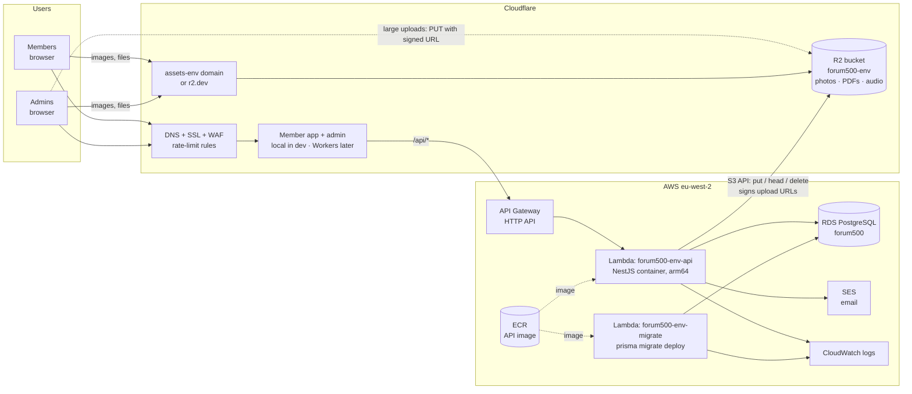
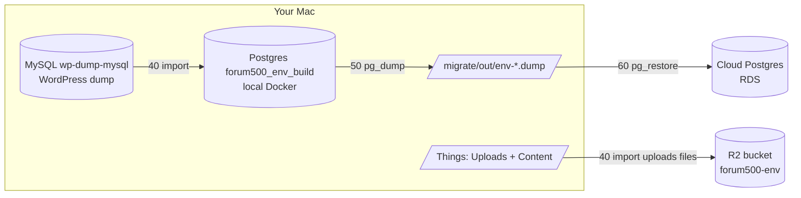

# Forum500 migration: AWS + Cloudflare

How Forum500 runs and how the old forum.club data (WordPress database + uploads) gets into each environment.
Decided 24 Oct 2026:
- **AWS + Cloudflare only.**
- **API on AWS Lambda.**
- **Files on Cloudflare R2**, because it costs nothing at this size and has no download fees.

The scripts in this folder build **dev** end to end. Staging and production follow the same data path (§5); their
infrastructure is the private-network layout of [Plan 2](../docs/deploy-plans/PLAN_2_AWS_LAMBDA_AURORA.md).

---

## 1. System architecture



**How a request flows:**
- **Browser to API:** browser → Cloudflare → API Gateway → Lambda `api`. The NestJS app starts once per Lambda instance, roughly 1–3 s, and stays warm for the requests that follow.
- **Files:** never pass through Lambda when they are read. Browsers fetch them from R2's public domain.
- **Large admin uploads:** over 4 MB, the admin app asks the API for a signed URL and sends the file straight to R2, because Lambda accepts about 6 MB per request.
- **Migrations:** the separate `migrate` function runs them, from the same image. The API never migrates on start.
- **Email:** SES, using the Lambda role, with no keys stored. R2 uses its own keys (`S3_ACCESS_KEY_ID`), because Lambda reserves `AWS_ACCESS_KEY_ID` for itself.

### Environments

| | Dev (personal AWS + Cloudflare, free tier) | Staging / UAT | Production |
|---|---|---|---|
| API | Lambda **outside** a VPC + API Gateway | Lambda in a private VPC (no NAT) | Lambda in a private VPC (no NAT) + worker Lambda |
| Database | RDS `db.t4g.micro`, **public with SSL** (Lambda has no fixed IP) | RDS / Aurora Serverless v2, private | Aurora Serverless v2 or RDS Multi-AZ, private |
| Files | R2 `forum500-dev` | R2 `forum500-staging` | R2 `forum500-prod` on `assets.forum500.club` |
| Lambda → R2 / SES | Direct (internet) | IPv6 egress-only gateway (free; R2 and SES have IPv6, needs a spike), or uploads only via signed URLs + worker | same |
| Web + admin | `npm run dev` on your Mac against the cloud API | Cloudflare Workers | Cloudflare Workers |
| Email | `log`, or SES sandbox (only verified addresses) | SES sandbox | SES production access |
| Built by | `migrate/*.sh` (this folder) | Terraform per Plan 2 (to do) | Terraform per Plan 2 (to do) |

### What dev costs
- **Lambda:** 1M requests and 400,000 GB-s are free every month.
- **API Gateway:** 1M calls a month free for 12 months, then about $1 per million.
- **ECR:** 500 MB free; the lifecycle rule keeps the last 3 images.
- **R2:** 10 GB free. One environment's files are about 1.9 GB.
- **RDS `db.t4g.micro`:** 750 h free on the old free tier (accounts created before 15 Jul 2025); about $15/month from the new plan's credits.
- **Public IPv4 address:** about $3.60/month on the database's address, unless it's covered by the old free tier.

**Set an AWS Budget alert ($5) first.** Stop the RDS instance when you're not using it (`aws rds stop-db-instance`). AWS starts it again by itself after 7 days.

---

## 2. What gets migrated (from `Forum500/Things`)

| Source | Goes to | Size |
|---|---|---|
| `DB_DUMP/*.sql`, loaded into the local MySQL `wp-dump-mysql` (127.0.0.1:3307, db `wp`) | Read by the importer | 208 MB dump |
| `Uploads/uploads.zip/` (a folder) | Only the files the content uses → the environment's **R2 bucket** under `uploads/wp/…` | 5.5 GB in, ~1.9 GB / ~1,388 files out |
| `Content/` (magazine RTFs + images) | Articles + images (R2) | 51 MB |
| `Wordpress/*.xml` | Count cross-check only | 15 MB |
| Result | The environment's **Postgres**: members, logins (WordPress passwords keep working), messages, newsletters, content, old-URL redirects | ~20 MB |

**Rule:** file URLs are written into the database rows at import time. So **every environment gets its own import
with its own bucket settings**. Never copy a database between environments, and never promote the local rehearsal
database (it holds `http://localhost:4000` URLs).

---

## 3. Data path (every environment)



The import runs on the Mac, because only the Mac has the dump and the 5.5 GB uploads folder. It writes into a local
build database, with **the target environment's R2 settings**, so the files land in the right bucket and the URLs are
right from the start. The finished ~20 MB database is then dumped and restored into the cloud database.

---

## 4. Dev: step by step

### 4.1 One-time accounts and keys (about 15 minutes, in the browser)
1. **AWS:**
   - Sign in.
   - Create a Budget alert ($5).
   - Create an access key for your user, or use `aws login` (SSO).
   - On the Mac: `aws configure --profile forum500-dev`, with region `eu-west-2`.
2. **Cloudflare:**
   1. Enable R2 once (R2 → Purchase/Enable; it asks for a card but doesn't charge within the free limit).
   2. Copy the **Account ID** (shown in the dashboard's right sidebar).
   3. **API token** for the scripts: My Profile → API Tokens → Create → Custom token → *Account · Workers R2 Storage · Edit*. If you'll use a custom files domain, also add *Zone · DNS · Edit* and *Zone · Zone · Read*.
   4. **R2 keys** for the app: R2 → Manage API tokens → Create API token → *Object Read & Write*. You can only scope it to `forum500-dev` after the bucket exists, so either run `10-r2-bucket.sh` first and then create the key, or create it for all buckets now and narrow it later. Copy the Access Key ID and Secret Access Key.
3. Fill in `migrate/env/dev.env`. It's already created from `env/dev.env.example`, with the secrets and local values filled in. Only `CF_ACCOUNT_ID`, `CF_API_TOKEN`, `R2_ACCESS_KEY_ID` and `R2_SECRET_ACCESS_KEY` remain.

### 4.2 Run it
```bash
cd Forum500/Monorepo
docker start forum500-postgres wp-dump-mysql      # local sources
./migrate/run.sh dev you@example.com              # all steps below, in order; asks before replacing anything
```
Or step by step. Every script is safe to re-run.

| Script | Does | Time |
|---|---|---|
| `00-check.sh dev` | Tools, settings, AWS login, Cloudflare token, local MySQL/Postgres, Things folders. Read-only | seconds |
| `10-r2-bucket.sh dev` | R2 bucket, public domain (custom or r2.dev), CORS, write test | seconds |
| `20-aws-base.sh dev` | Security group, **RDS PostgreSQL** (public, SSL), ECR repository, Lambda IAM role | 5–10 min (RDS) |
| `30-deploy-api.sh dev` | Builds the Lambda image (arm64) → ECR → creates/updates `forum500-dev-api` + `forum500-dev-migrate` → API Gateway → runs migrations → health check. **Re-run for every API deploy** | 3–5 min |
| `40-import-local.sh dev` | Local `forum500_dev_build`: schema, app content (`SEED_PROFILE=site`), WordPress dry run, then the import, uploading files to R2; checks no localhost URLs are left | 5–15 min (upload speed) |
| `50-dump.sh dev` | `pg_dump` → `migrate/out/dev-*.dump` | seconds |
| `60-restore.sh dev` | Backs up the cloud data if there is any, then `pg_restore` into RDS | ~1 min |
| `70-create-admin.sh dev you@example.com` | Admin login (asks for the password) | seconds |
| `80-verify.sh dev` | API health, counts (75 newsletters, 355 messages, 16 WhatsApp groups, 43 gallery photos), no placeholders, no localhost URLs, sample files load from R2 | seconds |
| `90-frontends-local.sh dev` | Starts web (:3002) and admin (:3001) on the Mac against the cloud API | — |

Saved outputs (RDS endpoint, API URL, R2 public URL, last dump) are in `migrate/out/dev.state`. Dumps are in
`migrate/out/`. Both are git-ignored, because they hold member data.

### 4.3 Optional: Cloudflare in front of the API (custom domain)
1. **Certificate:** in ACM (eu-west-2), request a certificate for `api-dev.yourdomain.com` and add the validation CNAME in Cloudflare DNS (DNS only, grey cloud).
2. **Custom domain:** API Gateway → Custom domain names → `api-dev.yourdomain.com` with that certificate. Add an API mapping to the `forum500-dev-api` API, stage `$default`.
3. **DNS record:** Cloudflare DNS → CNAME `api-dev` → the API Gateway domain name it shows, **proxied** (orange cloud). SSL/TLS mode: Full (strict).
4. **Origin secret:** Cloudflare → Rules → Transform Rules → Modify Request Header → *Set static* `x-origin-secret` = a random 32-character value, for hostname `api-dev.yourdomain.com`.
5. **Settings:** in `dev.env`, set `ORIGIN_SECRET=` (the same value) and `API_PUBLIC_URL=https://api-dev.yourdomain.com`. Then re-run `30-deploy-api.sh dev`. From then on the raw API Gateway address refuses requests, and rate limits use the real visitor IP (`CF-Connecting-IP`).
6. **Rate limiting:** Cloudflare → Security → WAF → Rate limiting rules, e.g. 100 requests per 10 s per IP on `/api/auth/*`.

### 4.4 Optional: real email in dev
1. SES (eu-west-2) → Identities → verify your domain (add the 3 DKIM CNAMEs in Cloudflare DNS) or your own address.
2. In sandbox mode SES only delivers to verified addresses, which is ideal for dev with real member data.
3. Set `MAIL_DRIVER=ses` and `MAIL_FROM="Forum500 Dev <no-reply@yourdomain.com>"` in `dev.env`, then re-run `30-deploy-api.sh dev`.

---

## 5. Staging / UAT and production

**Same data path (§3), different infrastructure:**
1. **Infrastructure** per [Plan 2](../docs/deploy-plans/PLAN_2_AWS_LAMBDA_AURORA.md):
   - private VPC without NAT
   - Aurora Serverless v2 or RDS, not public
   - Lambda in the VPC
   - Workers for the frontends
   - SES production access for prod

   `20-aws-base.sh` refuses to run for `prod`, because it makes the database public.
2. **API:** `30-deploy-api.sh` works unchanged once the functions exist. For a VPC function, create it with `--vpc-config` once; the script then updates the code and settings. Migrations run through the `migrate` function, which reaches the private database from inside the VPC.
3. **Data:**
   - Run `40-import-local.sh staging` / `prod` with that environment's R2 settings, then `50-dump.sh`.
   - The private database can't be reached from the Mac. Restore through **AWS CloudShell → "Create VPC environment"** in the database's VPC: upload the ~20 MB dump, then `pg_restore --clean --if-exists --no-owner --no-acl -d "$DATABASE_URL" file.dump`. Or use a one-off restore Lambda that reads the dump from S3.
   - Then create the admins with the same `create-admin.mjs` from CloudShell, or through the migrate function.
4. **Production cut-over day:**
   1. Announce the date, then put WordPress in maintenance mode.
   2. Take a **fresh** SQL dump plus the uploads added since 21 Oct.
   3. Reload MySQL: `DROP DATABASE wp; CREATE DATABASE wp …; import`. Merge the new month folders into `Things/Uploads/uploads.zip/`.
   4. Run `40` → `50` → restore → admins → `80-verify.sh prod`.
   5. Switch forum.club DNS to the new app. Old URLs redirect through the imported redirect table.
   6. Keep WordPress offline but intact for 30 days.
5. **Staging holds real member data:** keep it behind Cloudflare Access and SES sandbox, with `MAIL_DRIVER=log` until sign-off.

---

## 6. Day-to-day

| Task | Command |
|---|---|
| Deploy a new API version | `./migrate/30-deploy-api.sh dev` (builds, pushes, updates both functions, migrates) |
| Re-import after an importer fix | `./migrate/40-import-local.sh dev` → `50` → `60` (files already in R2 are skipped) |
| API logs | `aws logs tail /aws/lambda/forum500-dev-api --follow` |
| Migration status | `aws lambda invoke --function-name forum500-dev-migrate --cli-binary-format raw-in-base64-out --payload '{"action":"status"}' /dev/stdout` |
| Pause the database (saves money) | `aws rds stop-db-instance --db-instance-identifier forum500-dev` (auto-starts after 7 days) |
| Remove everything in dev | Delete the API Gateway API, both Lambdas, the ECR repo, the RDS instance (take a snapshot if wanted), the security group, the IAM role, the R2 bucket |

## 7. Known limits in dev
- **Cold start:** the first request after idle takes ~1–3 s.
- **Rate limits:** the app's own limits count per Lambda instance. Cloudflare rules (§4.3) are the real protection.
- **Database exposure:** the database is reachable from the internet, protected by SSL and a 32-character password. Don't reuse that password anywhere.
- **Chat:** chat pages poll every 15 s, about 240 requests an hour per open page, which is fine inside the free tier.
